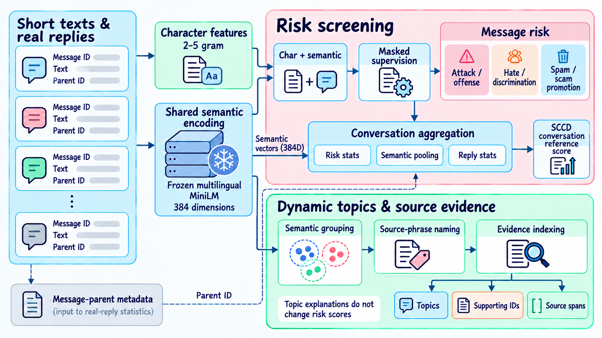
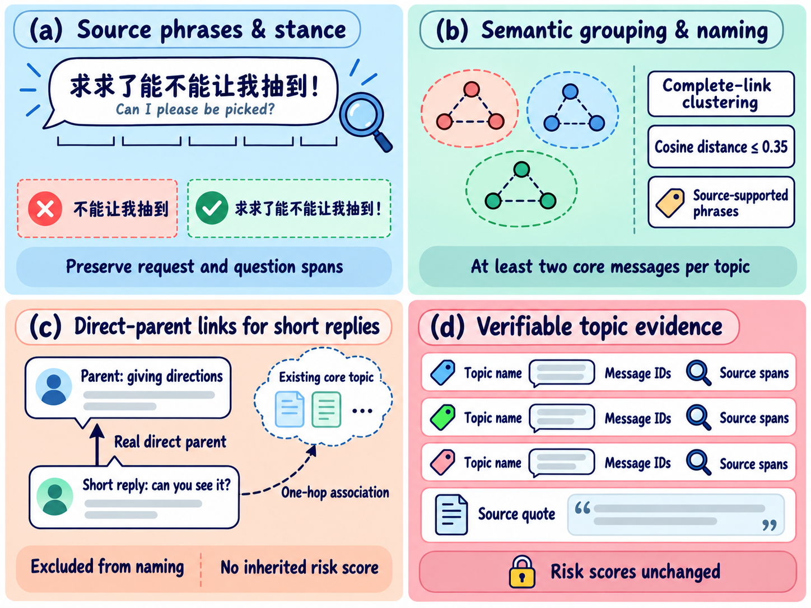

<p align="center">
  <picture>
    <source media="(prefers-color-scheme: dark)" srcset="assets/logo-lockup-dark.svg">
    
  </picture>
</p>

<p align="center"><strong>Discover discussion topics in short texts. Trace risk clues to their source.</strong></p>
<p align="center">One local model bundle · Two analysis branches · Verifiable message evidence</p>

<p align="center">
  <a href="https://www.python.org/downloads/"></a>
  <a href="https://nodejs.org/"></a>
  
  
  <a href="LICENSE"></a>
  <a href="https://github.com/Kirito14IT/CST-MIL/actions/workflows/release.yml"></a>
</p>

<p align="center">
  <a href="https://github.com/Kirito14IT/CST-MIL/releases/tag/demo-2026.10.15">Model release</a> ·
  <a href="#quick-start">Quick start</a> ·
  <a href="#architecture-and-outputs">Architecture</a> ·
  <a href="#research-code-and-reproducibility">Research code</a>
</p>

## Watch a real workflow

<p align="center"><a href="assets/demo.mp4"></a></p>

<p align="center"><a href="assets/demo.mp4">HD MP4</a> · <a href="assets/demo-poster.png">Static preview</a></p>

The English interface walks through a fictional campus discussion: **import → analyze → inspect topics → locate source text → save a review note**. The example demonstrates application functionality; it is separate from the paper's experimental data.

## What it does

CST-MIL combines semantic representations and character features for short social comments and chat messages. It separates three kinds of output:

| Output | Question | What you can inspect |
|---|---|---|
| **Fixed risk categories** | Which messages contain attack/offense, hate/discrimination or spam/scam-promotion clues? | Per-category scores, thresholds and supporting messages |
| **Dynamic discussion topics** | What is the conversation about? Which messages form a semantic group? | Source-grounded phrases, core members and direct-parent associations |
| **Candidate evidence** | Which passages should be checked first? | Top-3 candidates, message IDs, quotes and character spans |

Deployment loads **one model bundle**. Risk categories support multilabel outputs; discussion topics use semantic clustering with constrained parent-reply associations. These are distinct concepts. The overall clue score is the maximum score across messages and categories. The SCCD conversation score appears separately as a reference, not a validated risk probability for arbitrary domains.

## Architecture and outputs

### From messages to risk clues and discussion topics

<p align="center"><a href="assets/algorithm-overview-en.png"></a></p>

The figure shows the main processing paths. Reply statistics also use real parent IDs, semantic representations and message risk. Topic grouping uses stance and risk-distance constraints; explanation outputs do not change risk scores.

- **Shared encoding:** a frozen multilingual MiniLM provides 384-dimensional vectors, with chunking for long messages. One encoding pass serves both branches.
- **Lightweight supervision:** character 2–5 grams and semantic vectors feed three logistic-regression heads. Label masks preserve unobserved categories as unknown; source/class weights balance supervision.
- **Conversation aggregation:** SCCD supervision trains risk statistics, PCA-based semantic aggregation and real-reply statistics. Three-fold conversation cross-fitting supplies out-of-fold message scores during training.
- **Topic interpretation:** cosine-based hierarchical clustering yields a variable number of topics with source-grounded names and keyword spans. Eligible short replies may link to their real direct parent's topic without inheriting its risk score.
- **Local application:** React, an Express serial queue, a resident Python worker and SQLite provide source navigation, review notes, history and CSV/JSON export.

### How topics link back to source text

<p align="center"><a href="assets/topic-evidence-en.png"></a></p>

Names retain the source spans needed to preserve negation and questions. Core topic members and parent-linked short replies are recorded separately. Linked replies are excluded from naming statistics and do not inherit their parent's risk score. Supporting message IDs and character spans connect each topic back to its source text.

This release is a **supervised, pretrained-semantic-enhanced approach**. The repository also includes weakly supervised CST-MIL and adapters for LDA, BTM, GSDMM, NMF and BERTopic. Historical SCCD results do not represent this release. Topic names, sarcasm, discouragement and very short replies may still be misinterpreted; candidate evidence needs contextual review.

## Quick start

The following path targets **Windows PowerShell, Python 3.12, Node.js 24 and CPU**. Initial asset preparation needs internet access. Analysis does not call a paid model API.

```powershell
git clone https://github.com/Kirito14IT/CST-MIL.git
cd CST-MIL

py -3.12 -m venv cst_mil/.venv
.\cst_mil\.venv\Scripts\Activate.ps1
python -m pip install --upgrade pip
python -m pip install torch==2.8.0 --index-url https://download.pytorch.org/whl/cpu
python -m pip install -r WebApp/requirements-algorithm.txt
python -m pip install --no-deps -e ./cst_mil

python -m cst_mil.deployment setup
python -m cst_mil.deployment verify

cd WebApp
npm ci
npm start
```

Open http://127.0.0.1:3210
Select a built-in campus example or import comments. On later runs, enter the same `WebApp` directory and run `npm start`. Startup verifies model identity and builds the interface; it does not train models or silently download assets.

`setup` downloads a fixed-release model and a pinned upstream encoder, supports resumable downloads and SHA-256 checks, and creates `.runtime/deployment.json` inside the repository. Missing assets or fingerprint mismatches produce explicit errors.

<details>
<summary>Offline asset import and verification</summary>

Obtain the release ZIP and complete pinned encoder directory first, then run from the repository root:

```powershell
python -m cst_mil.deployment setup --model-archive "path/to/cst-mil-semantic-model-demo-2026.10.15.zip" --encoder-source "path/to/paraphrase-multilingual-MiniLM-L12-v2" --offline
python -m cst_mil.deployment verify
```

Paths may contain spaces. Offline installation performs the same integrity checks and does not accept an arbitrary model with a matching filename.

</details>

## Model, data and terms

| Asset | Distribution | Notes |
|---|---|---|
| Trained weights | [Release attachment](https://github.com/Kirito14IT/CST-MIL/releases/tag/demo-2026.10.15) | Fixed seed 42, full five-source training architecture; model file approximately 1.43 MiB |
| Multilingual encoder | Pinned upstream download through `setup` | Approximately 476 MiB, excluding Python dependencies; [upstream model](https://huggingface.co/sentence-transformers/paraphrase-multilingual-MiniLM-L12-v2) |
| Model identity and SHA-256 | [Public asset manifests](models/) | Weights, encoder and explanation configuration are bound; startup and results record their identity |
| Raw training data | Not redistributed in this repository or release | Obtain it separately and follow each source's terms |
| Experimental results | Not distributed | Per-example predictions, evaluation metrics, run logs, timing records and research reports remain private |

| Source | Language / setting | Supervision used here |
|---|---|---|
| [SCCD](https://github.com/STAIR-BUPT/SCCD) | Chinese Weibo conversations | Comment attack labels and separate conversation labels |
| [CONDA](https://github.com/usydnlp/CONDA) | English game chat | Attack / offense |
| [ToxiCN](https://github.com/DUT-lujunyu/ToxiCN) | Chinese social comments | Offense and hate |
| [ScamSpot](https://github.com/ScamSpot/scamspot_ig-comment-scraper) | Instagram financial comments, mainly English | Combined spam / scam label |
| [HateBR](https://github.com/franciellevargas/HateBR) | Portuguese Instagram comments | Offense |

Joint training preserves train/dev/test separation; unobserved categories are not assumed negative. Text is not uniformly truncated to 30 characters, and lengths and label definitions differ by source. ScamSpot is not a pure fraud-detection task. A multilingual encoder's supported languages are not equivalent to independently validated performance in every language.

Original code uses the [MIT license](LICENSE). Released weights have separate [model terms](MODEL_LICENSE.md) and **are not covered by the code's MIT license**. Third-party encoders, algorithms and datasets retain their own terms; see [third-party notices](THIRD_PARTY_NOTICES.md). The default service binds to localhost.

## Research code and reproducibility

**The pretrained demonstration and public code tests can be run directly.** Full research training also requires lawful access to the source data and reconstruction of label mappings, duplicate components, group splits and frozen input manifests. Experimental predictions, evaluation metrics, timing records, run logs, private audit materials and research reports are not redistributed. This release therefore does not promise one-command reproduction of the full five-source experiment.

The repository contains implementation code, synthetic test fixtures, fictional demonstration inputs and deployment manifests. Datasets are a separate asset category and may only be redistributed under their source terms. Trained deployment weights have their own release and license. Keep newly generated experimental results outside the tracked source tree; the public application does not bundle historical benchmark scores.

From the repository root in the Python environment above, inspect the actual entry points:

```powershell
# Joint comparison: preparation, training, evaluation, cost and summary stages
python -m cst_mil.research_followup.full_joint_comparison --help

# Fixed-protocol semantic follow-up, mechanism ablations and topic interpretation
python -m cst_mil.research_followup.semantic_patent_followup --help

# Historical SCCD baseline adapters
cst-bench --help
```

`full_joint_comparison` consumes SCCD partitions and short-text `candidates / source_catalog / components / exclusions` manifests. The semantic follow-up additionally consumes joint-comparison models, out-of-fold predictions and topic-development cases. `--help` lists parameters; it does not generate these prerequisites. Use a new output directory for new research runs and record data, code and encoder fingerprints. Additional baseline dependencies and pinned upstream retrieval are described in [baseline/](baseline/README.md).

## Development and tests

```powershell
# In WebApp: type checking, production build and asset-free UI contracts
npm run build
npx tsx --test tests/ui-source.test.ts tests/portable-deployment.test.ts
```

The [CI workflow](.github/workflows/release.yml) runs synthetic-data Python tests, portable-deployment tests, the frontend build and Node checks without private data. Real-model integration and browser checks require model assets.

## Repository layout

```text
CST-MIL/
├── assets/                         # Original logo, architecture, real demo GIF/MP4
├── models/                         # Public asset manifests
├── cst_mil/
│   ├── src/cst_mil/                # Algorithms, portable deployment, research stages
│   └── tests/                      # Python tests
├── baseline/                       # Pinned upstream retrieval and notices
├── WebApp/                         # Demo UI, server, Python worker and tests
└── .github/workflows/              # Public CI checks
```

Use [Issues](https://github.com/Kirito14IT/CST-MIL/issues) to report a minimal input and environment. Remove personal information before sharing examples. For topic-quality feedback, source text and the expected interpretation are more useful than a score screenshot alone.
