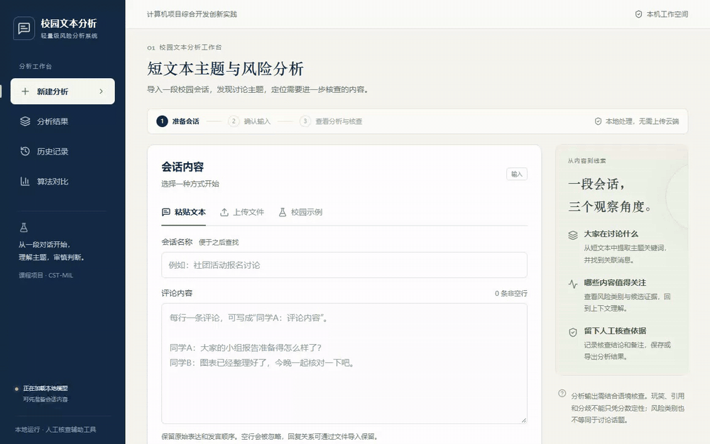
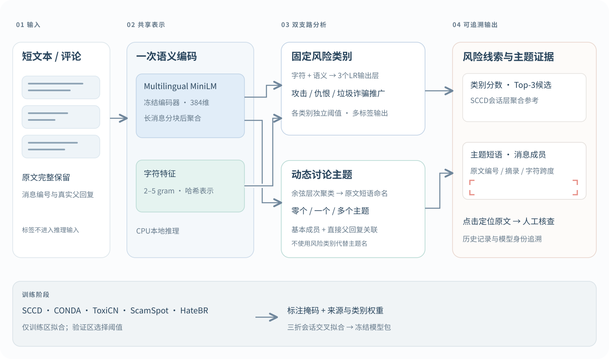

<p align="center">
  <picture>
    <source media="(prefers-color-scheme: dark)" srcset="assets/logo-lockup-dark.svg">
    
  </picture>
</p>

<p align="center"><strong>从短文本中发现讨论主题，把风险线索定位到原文。</strong></p>
<p align="center">一个本地模型包 · 两条分析支路 · 可核对的消息证据</p>

<p align="center">
  <a href="https://www.python.org/downloads/"></a>
  <a href="https://nodejs.org/"></a>
  
  
  <a href="LICENSE"></a>
  <a href="https://github.com/Kirito14IT/CST-MIL/actions/workflows/release.yml"></a>
</p>

<p align="center"><strong>简体中文</strong> · <a href="README.en.md">English</a></p>

<p align="center">
  <a href="https://github.com/Kirito14IT/CST-MIL/releases/tag/demo-2026.10.15">下载模型</a> ·
  <a href="#快速启动">快速启动</a> ·
  <a href="#算法与输出">算法框架</a> ·
  <a href="#研究代码与复现边界">研究复现</a>
</p>

## 看一次真实操作

<p align="center"><a href="assets/demo.mp4"></a></p>

<p align="center"><a href="assets/demo.mp4">高清 MP4</a> · <a href="assets/demo-poster.png">静态预览</a></p>

演示使用校园比赛评论案例，依次完成 **导入 → 分析 → 查看主题 → 定位原文 → 保存核查备注**。主题、分数和摘录均来自实际运行。该案例用于展示功能。

## 这个项目做什么

CST-MIL面向社交评论、聊天室消息等短文本，联合使用语义表示与字符线索，提供三类可分别理解的结果：

| 输出 | 回答的问题 | 查看方式 |
|---|---|---|
| **固定风险类别** | 哪些消息出现攻击／冒犯、仇恨／歧视、垃圾／诈骗推广线索？ | 独立类别分数、阈值和对应消息 |
| **动态讨论主题** | 这段讨论在谈什么？哪些消息形成语义组？ | 原文短语命名、基本成员与直接父回复关联 |
| **候选证据** | 需要优先核对哪些原文？ | Top-3候选、消息编号、摘录和字符跨度 |

部署时只加载**一个模型包**。风险类别允许多标签；讨论主题采用语义聚类及受约束的父回复关联，两者不是同一个概念。页面的总体线索分数是各消息、各类别分数的最大值；SCCD会话层分数另列为参考，不把它称为任意场景下的会话风险概率。

## 算法与输出



- **共享编码**：冻结的多语言MiniLM提供384维语义向量，长消息分块编码；一次编码同时服务风险与主题支路。
- **轻量监督层**：字符2–5 gram与语义向量组合，三个逻辑回归输出层分别训练。标注掩码使未标注的类别保持未知；来源与类别权重控制监督比例。
- **会话聚合**：使用SCCD会话训练风险统计、PCA语义聚合和真实回复统计，训练时以三折会话交叉拟合产生折外消息分数。
- **主题解释**：余弦层次聚类形成可变数量的主题，名称和关键词保留原文依据；短回复只在满足约束时关联真实直接父消息的主题，不继承其风险分数。
- **本地演示**：React页面、Express串行队列、常驻Python模型与SQLite历史记录，支持原文跳转、核查备注及CSV／JSON导出。

这是**预训练语义增强的监督方案**。仓库同时含有弱监督CST-MIL和LDA、BTM、GSDMM、NMF、BERTopic适配代码；早期SCCD成绩不能替代当前发布模型的成绩。主题命名、反讽、劝阻及极短回复仍可能出错，候选证据需结合上下文核查。

## 快速启动

下面是 **Windows PowerShell / Python 3.12 / Node.js 24 / CPU** 的安装路径。首次准备模型需要联网；运行分析不调用付费模型API。

```powershell
git clone https://github.com/Kirito14IT/CST-MIL.git
cd CST-MIL

py -3.12 -m venv cst_mil/.venv
.\cst_mil\.venv\Scripts\Activate.ps1
python -m pip install --upgrade pip
python -m pip install torch==2.8.0 --index-url https://download.pytorch.org/whl/cpu
python -m pip install -r "计算机项目综合开发创新实践/app/requirements-algorithm.txt"
python -m pip install --no-deps -e ./cst_mil

python -m cst_mil.deployment setup
python -m cst_mil.deployment verify

cd "计算机项目综合开发创新实践/app"
npm ci
npm start
```

打开 http://127.0.0.1:3210 
选择内置校园示例或导入自己的评论。以后进入同一 `app` 目录运行 `npm start` 即可；启动会检查模型身份并构建页面，不训练模型、不隐式下载资产。

`setup`从固定Release下载模型，从固定上游版本取得编码器，支持断点下载和SHA-256校验，生成仓库内的 `.runtime/deployment.json`。模型缺失或指纹不匹配会明确报错。

<details>
<summary>离线资产导入与再次校验</summary>

先取得Release中的模型ZIP和完整的固定版本编码器目录，再从仓库根目录运行：

```powershell
python -m cst_mil.deployment setup --model-archive "path/to/cst-mil-semantic-model-demo-2026.10.15.zip" --encoder-source "path/to/paraphrase-multilingual-MiniLM-L12-v2" --offline
python -m cst_mil.deployment verify
```

路径可以包含空格。离线方式仍执行相同的完整性校验，不接受任意同名模型替换。

</details>

## 模型、数据与使用条件

| 资产 | 发布方式 | 说明 |
|---|---|---|
| 训练权重 | [Release附件](https://github.com/Kirito14IT/CST-MIL/releases/tag/demo-2026.10.15) | 固定seed42、五来源全量训练架构；模型文件约1.43 MiB |
| 多语言编码器 | `setup`按固定上游版本下载 | 约476 MiB，另计Python依赖；[模型来源](https://huggingface.co/sentence-transformers/paraphrase-multilingual-MiniLM-L12-v2) |
| 模型身份与SHA-256 | [公开模型清单](models/) | 权重、编码器与解释配置绑定，启动和结果均记录身份 |
| 原始训练数据 | 不在仓库或模型附件中重新分发 | 请从下列来源单独取得，并遵守各自使用条件 |

| 来源 | 语言／场景 | 本方案使用的监督 |
|---|---|---|
| [SCCD](https://github.com/STAIR-BUPT/SCCD) | 中文微博会话 | 评论攻击标签及独立会话标签 |
| [CONDA](https://github.com/usydnlp/CONDA) | 英文游戏聊天室 | 攻击／冒犯 |
| [ToxiCN](https://github.com/DUT-lujunyu/ToxiCN) | 中文社交评论 | 冒犯与仇恨 |
| [ScamSpot](https://github.com/ScamSpot/scamspot_ig-comment-scraper) | Instagram金融评论，英语为主 | 垃圾／诈骗合并类别 |
| [HateBR](https://github.com/franciellevargas/HateBR) | 葡萄牙语Instagram评论 | 冒犯 |

五个来源联合训练，保留训练、验证、测试隔离；未标注类别不自动视为阴性。原文不统一截断为30字，数据长度与标签定义也不完全相同。ScamSpot结果不能称为纯诈骗识别，多语言编码器的支持范围也不等于所有语言均已充分验证。

自有代码适用 [MIT](LICENSE)。发布权重遵守单独的 [模型使用条款](MODEL_LICENSE.md)，**不属于代码MIT许可范围**。第三方编码器、算法与数据保留各自条件，见 [第三方声明](THIRD_PARTY_NOTICES.md)。默认服务仅监听本机。

## 研究代码与复现边界

**可直接复现的是预训练模型演示和公开代码测试。** 完整研究训练还需要依法取得原始数据，并重建来源标签、去重组件、分组划分与冻结输入清单。本仓库不重新分发这些逐条数据、私人审计材料或历史运行产物，因此不承诺执行一条命令即可复现全部五来源实验。

从仓库根目录、上述Python环境中，可查看实际研究入口：

```powershell
# 五来源联合比较：准备、训练、评估、成本及汇总阶段
python -m cst_mil.research_followup.full_joint_comparison --help

# 固定协议下的语义方案、机制消融及主题解释
python -m cst_mil.research_followup.semantic_patent_followup --help

# 历史SCCD基线适配器
cst-bench --help
```

`full_joint_comparison`读取SCCD分区及短文本来源的 `candidates / source_catalog / components / exclusions` 清单；语义补证入口进一步读取联合比较模型、折外预测及解释开发案例。`--help`只展示参数，不会生成这些前置材料。自建研究运行应使用新的输出目录，并记录数据、代码及编码器指纹。传统基线的额外环境与上游代码获取方式见 [baseline/](baseline/README.md)。

## 开发与测试

```powershell
# 当前app目录：类型检查、生产构建、无模型资产的界面契约测试
npm run build
npx tsx --test tests/ui-source.test.ts tests/portable-deployment.test.ts
```

[CI工作流](.github/workflows/release.yml)运行合成数据Python测试、便携部署测试、前端构建与无需私人数据的Node检查。真实模型集成和浏览器端到端检查需要先准备模型资产。

## 项目结构

```text
CST-MIL/
├── assets/                         # 原创Logo、核心框架、真实演示GIF/MP4
├── models/                         # 公开模型资产清单
├── cst_mil/
│   ├── src/cst_mil/                # 算法、部署适配与研究入口
│   └── tests/                      # Python测试
├── baseline/                       # 基线适配所需的上游获取入口与声明
├── 计算机项目综合开发创新实践/app/   # 演示前端、服务、Python worker及测试
└── .github/workflows/              # 可公开运行的CI检查
```

欢迎通过 [Issues](https://github.com/Kirito14IT/CST-MIL/issues)提交带有最小输入和运行环境的问题。分享案例时请自行去除个人信息；反馈主题质量时，保留原文与预期解释比只给一张分数截图更有帮助。
